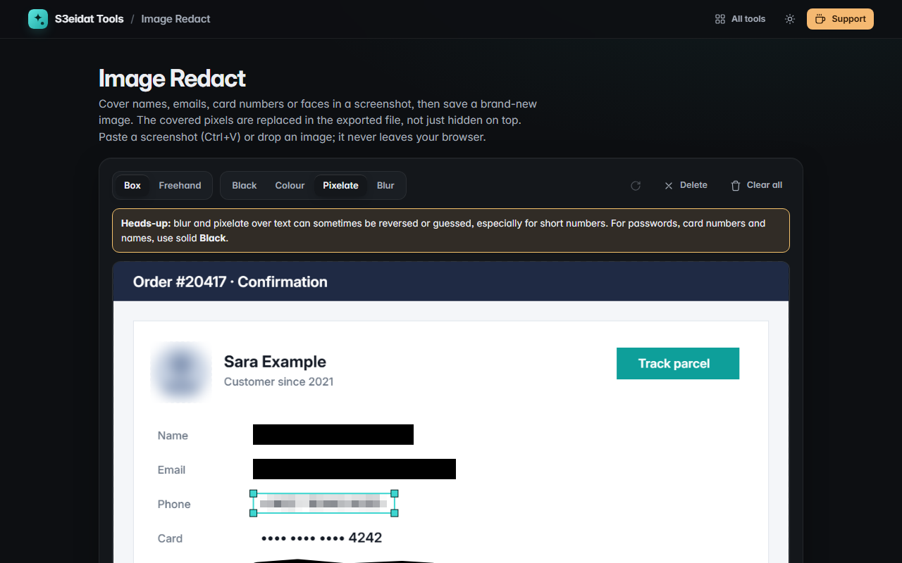

# Image Redact

> Hide private info in screenshots, for real. Free, private, and it runs entirely in your browser.

### ▶ [Open Image Redact](https://s3eidat.github.io/image-redact/)



## Features

- **Paste a screenshot** (Ctrl+V / Cmd+V), drop an image or open a file
- Draw **boxes** or **freehand** strokes over anything you want gone
- Cover styles: **solid black** (default, recommended), **solid colour**, **pixelate**, **blur**
- **Move, resize and delete** covers; arrow keys nudge, Delete removes, Ctrl+Z undoes
- Export a **new PNG or JPG at full resolution**: the image is redrawn with the covers burned into the pixels and
  re-encoded, so the covered pixels are really gone and no metadata (EXIF, GPS) is carried over
- **Copy** the redacted image straight to the clipboard (where the browser allows it)
- A warning appears when you use blur or pixelate: over text these can sometimes be reversed or guessed,
  so use solid black for passwords, card numbers and names

The built-in self-test exports a real file, decodes it again and checks that every pixel under a black box is black.

## Privacy

Your images never leave your device. There is no server, no account, no analytics.
The page ships with a strict Content-Security-Policy (`connect-src 'self'`), so the browser
itself blocks any attempt to send data anywhere.

## Run it yourself

It's plain HTML, CSS and JavaScript with no build step:

```bash
git clone https://github.com/s3eidat/image-redact
cd image-redact
python -m http.server 8000
```

Then open http://localhost:8000.

## Support

If this saved you time, **[buy me a coffee ☕](https://s3eidat.github.io/coffee/)**. It keeps every tool free.

---

Part of **[S3eidat Tools](https://s3eidat.github.io/)**: 100+ free, private tools that run in your browser. MIT licensed.
